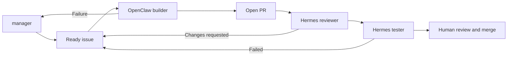

# Daily Briefing delivery report

Complete this after real VM runs. Replace placeholders with GitHub issue/PR URLs and observed evidence. Never report estimated counts as measured.

## Live system

- Public briefing URL: TODO
- Repository and revision: TODO
- Oracle VM shape and region: TODO
- Reproduction: `terraform -chdir=infra init`, `terraform -chdir=infra apply`, clone the repository, fill `agents/secrets.env`, run `bash agent-setup.sh`, authenticate `gh`, run `bash agents/enable-queue.sh`, and start `bash agents/dispatch.sh manager`. Record any extra product service commands here.

## Agent roster and contributions

| Agent | Runtime | Actual work | Issue/PR evidence |
| --- | --- | --- | --- |
| manager | Hermes | TODO | TODO |
| ingest | OpenClaw | TODO | TODO |
| page | OpenClaw | TODO | TODO |
| reviewer | Hermes | TODO | TODO |
| tester | Hermes | TODO | TODO |

## Ticket flow

## Results and trace

- First run, unchanged second run, one new item, and persisted failure: TODO with command output and public page evidence.
- Handoff issue comment and PR link: TODO.
- Review decision and test verdict: TODO.
- Failure, retry, and fix if one occurred: TODO. If none occurred, say so.
- Next change: TODO.

## Model usage

Run `bash agents/usage-report.sh` and use `.local-evidence/usage/*.json` as the local evidence. Hermes reports measured per-run totals; OpenClaw gateway files are before/after snapshots and require attribution or an explicitly labeled estimate. Include auxiliary Hermes tokens where recorded. Do not commit local evidence or credentials.

| Agent | Model | Planning tokens | Coding tokens | Review/test tokens | Retry tokens | Method |
| --- | --- | ---: | ---: | ---: | ---: | --- |
| manager | TODO | TODO | — | — | TODO | TODO |
| ingest | TODO | — | TODO | — | TODO | TODO |
| page | TODO | — | TODO | — | TODO | TODO |
| reviewer | TODO | — | — | TODO | TODO | TODO |
| tester | TODO | — | — | TODO | TODO | TODO |
