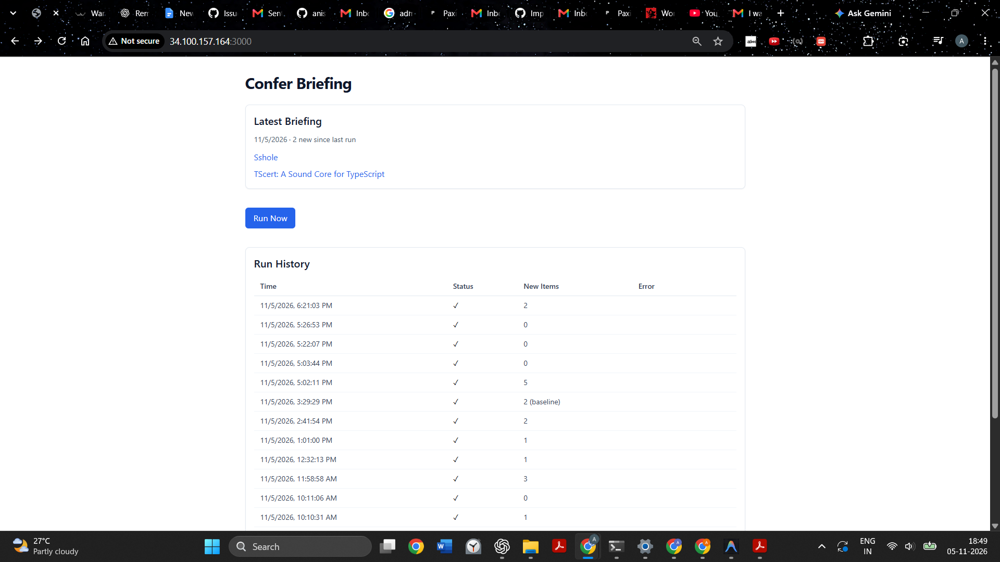
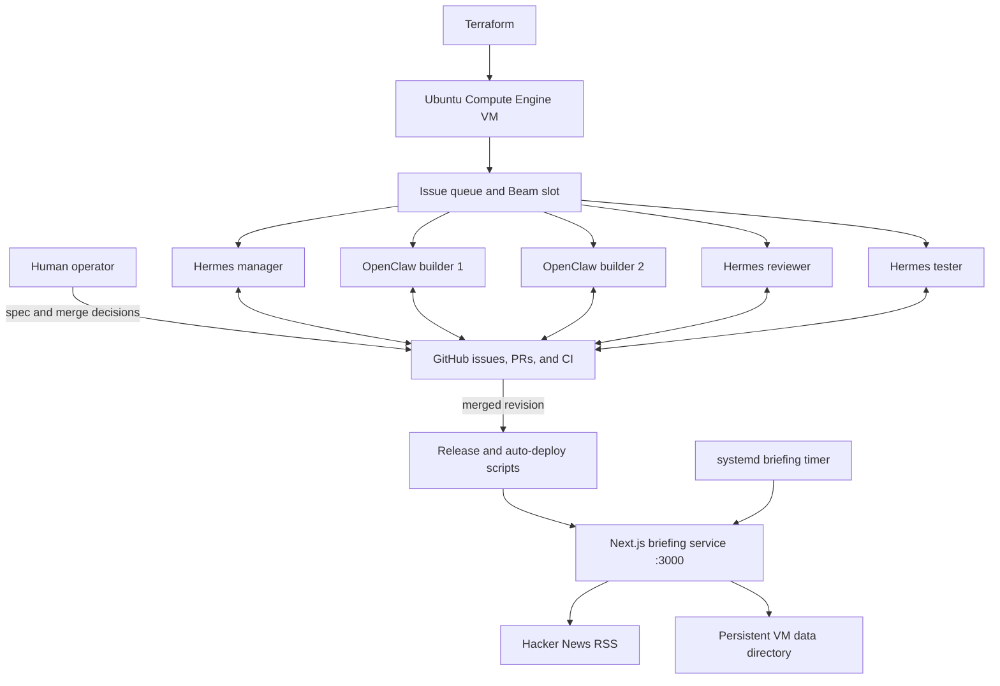

# Mini Software Factory

This repository is a software factory: a manager agent turns a product spec into GitHub issues, two builders implement the work, a reviewer and tester check each pull request, and a human merges approved changes. The factory then deploys a merged revision to a Google Cloud VM. Its first product, **Confer Briefing**, reads Hacker News RSS, records runs in local files, and serves a public briefing with a Run Now button.

The orchestration is reusable across product specs. The [briefing application](examples/breifing-product/README.md) is the worked example, and [its spec](examples/specs/spec.md) states the acceptance behavior. The [GitHub issues](https://github.com/anishs1207/confer-assignment/issues) and [PRs](https://github.com/anishs1207/confer-assignment/pulls) form the handoff trail. The [agent video](https://youtu.be/gJe6G2PsGt8) shows the factory operating.



The product was served at `http://34.100.157.164:3000` during the recorded run. Use `terraform -chdir=infra output -raw product_url` for the current VM address; the historical address may no longer be live.

## Architecture



[`infra/`](infra/) provisions one Ubuntu `n4-standard-2` VM (2 vCPUs, 8 GiB RAM) with a 30 GB boot disk, VPC, subnet, operator-limited SSH access, and public port 3000. Bootstrap installs the runtimes and starts the queue. All five roles used Ollama Cloud `beam` in the recorded campaign. A shared Beam lock serializes model-backed runs, so the two builders are separate agents in separate git worktrees, but their model calls do not run in parallel. [`agents/beam-slot.sh`](agents/beam-slot.sh) adds a cooldown between runs.

| Role | Runtime | Responsibility |
| --- | --- | --- |
| Manager | Hermes | Read the spec, plan and link issues, diagnose blocked work, arrange releases. |
| Builder 1 and 2 | OpenClaw | Implement assigned issues on isolated branches and open PRs with product checks. |
| Reviewer | Hermes | Compare the PR head with the issue, spec, diff, and CI; request fixes or approve. |
| Tester | Hermes | Run acceptance and regression checks against the reviewed PR head. |
| Human | GitHub | Inspect and merge `merge-ready` PRs. |

GitHub issues carry `factory:*` stage labels, one `agent:builder*` assignment for coding work, and a `product:<spec-hash>` campaign label. Dependencies are explicit: an issue unlocks only after its prerequisites close **and** their builder PRs merge. The queue, role prompts, author checks, watchdog, activity records, and release tooling live in [`agents/`](agents/README.md).

## End-to-end workflow

1. **Select a spec.** On the VM, start a campaign with a Markdown file, for example `bash agents/start-campaign.sh ./spec.md`, then tell the manager `implement ./spec.md` in [`agents/manager-chat.sh`](agents/manager-chat.sh). A new spec hash forms a new campaign after the previous one closes.
2. **Plan work.** The manager creates issues, acceptance criteria, assignments, and dependency links. The queue selects an unblocked issue and dispatches its builder.
3. **Build.** The builder works in an issue-specific git worktree, commits under its assigned identity, runs the product check, pushes a branch, and opens a linked PR. The factory verifies the PR head and commit authors. [GitHub Actions](.github/workflows/agent-pr.yml) runs the `verify` check.
4. **Review and test.** Once CI passes, the reviewer checks the current head and posts a head-bound verdict. The tester checks that head and posts a head-bound acceptance verdict. A failure returns the issue and PR to the builder. A new commit requires the gates to run again.
5. **Merge and unlock.** After review and test pass, the queue posts a successful `factory-gates` status and labels the issue `factory:merge-ready`. The human reviews and merges. The queue closes the issue and releases dependents.
6. **Release.** [`agents/release-product.sh`](agents/release-product.sh) prepares a versioned release from a merged commit, restarts the managed web service, and smoke-checks the live page, API, CSS, and JavaScript. It retains the previous release for rollback. A systemd [auto-deploy timer](agents/systemd/factory-autodeploy.timer) checks main each minute. Product history remains in `FACTORY_DATA_DIR`, outside release code.

The factory gate is a workflow check, not server-side branch protection. On the recorded private GitHub plan, the shared token could technically push or merge; role instructions and local push guards enforce the intended human merge process. Factory-only PRs have a documented auto-deploy exception to `factory-gates`, but still require a merged PR and passing `verify` check.

## Briefing product

The [Next.js product](examples/breifing-product/README.md) reads `https://news.ycombinator.com/rss` on a systemd schedule or through **Run Now**. It assigns each item a stable ID, compares it with stored history, and publishes only newly seen items. The first run is labeled as a baseline. Every run, including zero-new and failed runs, is persisted with its time, status, error if any, and observed items. The public page shows the latest dated briefing and a history row for every run. The Run Now API prevents overlap and rate limits repeated requests. Local files under `FACTORY_DATA_DIR` retain history across process restarts and releases.

## Reproduce and operate

You need a Google Cloud project with Compute Engine and billing, Terraform, `gcloud`, Python 3, git, SSH, an Ollama Cloud API key, and a GitHub token with repository access. Copy [`agents/.env.sample`](agents/.env.sample) to ignored `agents/secrets.env` and provide the keys. Commit and push the factory revision before bootstrap so the VM can clone that exact revision. See [SETUP.md](SETUP.md) for the full bootstrap and campaign recovery procedure.

```powershell
$env:GOOGLE_OAUTH_ACCESS_TOKEN = (gcloud auth print-access-token)
terraform -chdir=infra init
terraform -chdir=infra plan -out=tfplan
terraform -chdir=infra apply tfplan
terraform -chdir=infra output -raw manager_chat_command
terraform -chdir=infra output -raw product_url
```

On the VM, use the returned manager chat command. For a new campaign, place a spec in the VM repository, run `bash agents/start-campaign.sh ./spec.md`, and ask the manager to implement it. The checked-in briefing spec is a reference; [SETUP.md](SETUP.md) describes recovery of the historical campaign. Watch issues and PR checks for handoffs, then merge PRs marked `factory:merge-ready` with passing checks.

For a merged revision that needs manual deployment or recovery:

```sh
bash agents/release-product.sh deploy <merged-commit-sha>
bash agents/release-product.sh status
bash agents/release-product.sh rollback
```

Use `systemctl --user status factory-autodeploy.timer` and `journalctl --user -u factory-autodeploy.service -f` to inspect automatic deployment. A failed smoke check restores the prior release. The deployer waits 15 minutes between retries and stops after three failed attempts for one revision. [Recovery rules](agents/RECOVERY.md) cover rejected PRs and bad releases. On the VM, `bash agents/usage-report.sh` summarizes agent usage and `python3 agents/trace-report.py --output .local-evidence/trace-excerpts.md` extracts handoffs.

## Recorded campaign and lessons

The briefing work was developed through the [issue](https://github.com/anishs1207/confer-assignment/issues) and [PR](https://github.com/anishs1207/confer-assignment/pulls) trail. Builder 1 delivered setup, RSS parsing, the first public page, service integration, and a static-asset repair. Builder 2 delivered persistence, new-item detection, and the Run Now API. The manager planned and dispatched work; the reviewer and tester posted head-bound decisions; the human merged. One scheduler change, [issue #7](https://github.com/anishs1207/confer-assignment/issues/7), was a direct commit and illustrates a process enforcement gap.

The run exposed three failures. Builder 1 initially committed with Ubuntu's default Git identity; the factory now sets and verifies builder identity. A standalone Next.js release omitted static CSS and JavaScript; packaging and HTTP smoke checks were repaired. Broad process cleanup during review stopped the OpenClaw gateway; managed restart, preflight, and scoped HTTP checks were added. A watchdog was added after reviewer loops consumed tokens without progress.

Activity runs were matched to runtime sessions when the first main-model call fell within the run interval, allowing 20 seconds of tolerance and requiring a unique match. Tokens include input, output, cache read, cache write, and title-generation calls. **111,414,971 measured tokens** were attributed to 220 runs; four runs had unknown counts. Three additional Hermes sessions had **2,068,768 tokens** but no reliable activity or issue match, bringing the measured export total to **113,483,739**. OpenClaw per-run usage agreed exactly with trace events for 91 of 134 measured builder runs. These are historical measurements, not estimates for a new campaign.

| Agent | First dispatch tokens | Later dispatch tokens | Matched total | Unknown runs |
| --- | ---: | ---: | ---: | ---: |
| Manager | 18,877,369 | 13,754,867 | 32,632,236 | 2 |
| Builder 1 | 1,439,266 | 5,445,679 | 6,884,945 | 2 |
| Builder 2 | 1,544,157 | 9,302,269 | 10,846,426 | 0 |
| Reviewer | 16,280,837 | 20,009,752 | 36,290,589 | 0 |
| Tester | 15,068,603 | 9,692,172 | 24,760,775 | 0 |

The measured issue subtotals below include all matched roles. A dash means that issue had no builder PR; unmatched Hermes sessions and unknown run counts are excluded.

<details>
<summary>Per-issue agent usage and PRs</summary>

| Issue | PR or change | Manager | Builder1 | Builder2 | Reviewer | Tester | Measured subtotal |
| --- | --- | ---: | ---: | ---: | ---: | ---: | ---: |
| [#1](https://github.com/anishs1207/confer-assignment/issues/1) | [#10](https://github.com/anishs1207/confer-assignment/pull/10) | - | 653,093 / 2 runs | - | 1,582,003 / 2 runs | 779,622 / 1 run | 3,014,718 |
| [#2](https://github.com/anishs1207/confer-assignment/issues/2) | [#12](https://github.com/anishs1207/confer-assignment/pull/12) | 2,134,824 / 3 runs | 1,398,945 / 8 runs | - | 1,576,052 / 2 runs | 887,617 / 1 run | 5,997,438 |
| [#3](https://github.com/anishs1207/confer-assignment/issues/3) | [#11](https://github.com/anishs1207/confer-assignment/pull/11) | 1,241,695 / 2 runs | - | 1,094,725 / 9 runs | 1,559,406 / 2 runs | 1,381,225 / 1 run | 5,277,051 |
| [#4](https://github.com/anishs1207/confer-assignment/issues/4) | [#13](https://github.com/anishs1207/confer-assignment/pull/13) | 3,112,732 / 2 runs | - | 1,365,968 / 16 runs | 500,445 / 1 run | 674,035 / 1 run | 5,653,180 |
| [#5](https://github.com/anishs1207/confer-assignment/issues/5) | [#17](https://github.com/anishs1207/confer-assignment/pull/17) | - | 904,498 / 7 runs | - | 3,123,273 / 2 runs | 1,531,226 / 1 run | 5,558,997 |
| [#6](https://github.com/anishs1207/confer-assignment/issues/6) | [#14](https://github.com/anishs1207/confer-assignment/pull/14) | 1,662,893 / 2 runs | - | 1,035,912 / 5 runs | 4,777,834 / 3 runs | 3,816,723 / 1 run | 11,293,362 |
| [#7](https://github.com/anishs1207/confer-assignment/issues/7) | [direct commit](https://github.com/anishs1207/confer-assignment/commit/a2d113afd619bc4e4a51b0db605ee2a7672919dd) | 1,664,684 / 1 run | - | - | - | - | 1,664,684 |
| [#8](https://github.com/anishs1207/confer-assignment/issues/8) | [#15](https://github.com/anishs1207/confer-assignment/pull/15) | 4,605,349 / 4 runs | 1,536,996 + 2 unknown / 13 runs | - | 3,800,254 / 2 runs | 3,949,383 / 3 runs | 13,891,982 |
| [#9](https://github.com/anishs1207/confer-assignment/issues/9) | No builder PR | 2,101,497 / 2 runs | - | - | - | - | 2,101,497 |
| [#18](https://github.com/anishs1207/confer-assignment/issues/18) | [#20](https://github.com/anishs1207/confer-assignment/pull/20) | 1,478,464 / 1 run | 1,119,580 / 5 runs | - | 967,744 / 1 run | 3,191,117 / 2 runs | 6,756,905 |
| [#19](https://github.com/anishs1207/confer-assignment/issues/19) | No builder PR | 2,034,389 / 1 run | - | - | - | - | 2,034,389 |
| [#21](https://github.com/anishs1207/confer-assignment/issues/21) | [#30](https://github.com/anishs1207/confer-assignment/pull/30) | - | 664,654 / 5 runs | - | 2,037,115 / 2 runs | 1,374,579 / 1 run | 4,076,348 |
| [#22](https://github.com/anishs1207/confer-assignment/issues/22) | [#33](https://github.com/anishs1207/confer-assignment/pull/33) | - | - | 985,222 / 9 runs | 3,064,245 / 4 runs | 686,111 / 1 run | 4,735,578 |
| [#23](https://github.com/anishs1207/confer-assignment/issues/23) | [#35](https://github.com/anishs1207/confer-assignment/pull/35) | 1,999,097 / 2 runs | - | 2,022,452 / 15 runs | 2,467,957 / 3 runs | 1,083,013 / 1 run | 7,572,519 |
| [#24](https://github.com/anishs1207/confer-assignment/issues/24) | [#28](https://github.com/anishs1207/confer-assignment/pull/28) | 2,822,923 / 3 runs | - | 2,049,479 / 15 runs | 4,824,813 / 5 runs | 1,464,176 / 2 runs | 11,161,391 |
| [#25](https://github.com/anishs1207/confer-assignment/issues/25) | [#36](https://github.com/anishs1207/confer-assignment/pull/36) | - | - | 956,276 / 12 runs | 5,145,540 / 4 runs | 1,123,950 / 1 run | 7,225,766 |
| [#26](https://github.com/anishs1207/confer-assignment/issues/26) | [#37](https://github.com/anishs1207/confer-assignment/pull/37) | - | 607,179 / 3 runs | - | 863,908 / 1 run | 2,817,998 / 2 runs | 4,289,085 |
| [#27](https://github.com/anishs1207/confer-assignment/issues/27) | No builder PR | 1,855,177 / 1 run | - | - | - | - | 1,855,177 |
| [#29](https://github.com/anishs1207/confer-assignment/issues/29) | [#31](https://github.com/anishs1207/confer-assignment/pull/31) | 3,472,012 / 3 runs | - | 1,336,392 / 12 runs | - | - | 4,808,404 |
| Unassigned chat | No builder PR | 2,446,500 + 2 unknown / 4 runs | - | - | - | - | 2,446,500 |

</details>

Later builder dispatches consumed 14,747,948 of 17,731,371 measured builder tokens. The same Beam model served every role, so the proposed split between stronger analysis models and cheaper routine models was not implemented. The shared model slot also limits throughput. Useful next improvements are per-agent API keys and a usage dashboard, alerts for PRs awaiting human merge, role-specific model selection, and stronger instructions or skills for build, review, and test.
