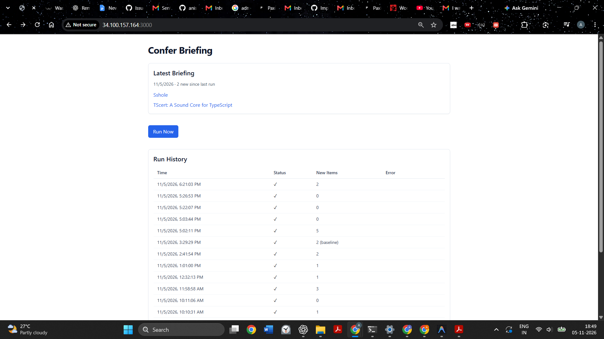
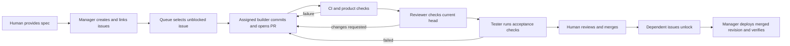

# Software Factory (Confer Briefing)

The task was to create a software factory that builds a briefing product using a team of OpenClaw and Hermes agents in manager, builder, reviewer, and tester roles. The factory runs on a Google Cloud VM (`n4-standard-2`, 2 vCPUs, 8 GiB RAM) with a 30 GB boot disk.

I communicated with the manager agent twice: first to provide the initial spec, and then to address an edge case and a problem loading CSS and JavaScript files. The manager broke this work into further tasks for the agents.

The product reads the public Hacker News RSS feed, compares stable item IDs against stored history, publishes the latest dated briefing and prior runs, and provides a guarded **Run Now** action. It uses Next.js, local files on the VM, and a systemd timer. The [spec](spec.md) defines the acceptance behavior.



| Resource                     | Link / Details                                                                                                                          |
| ---------------------------- | --------------------------------------------------------------------------------------------------------------------------------------- |
| Live Link                    | [http://34.100.157.164:3000](http://34.100.157.164:3000) (served from VM)                                        |
| GitHub Repository            | [https://github.com/anishs1207/confer-assignment](https://github.com/anishs1207/confer-assignment)              |
| Ticket Trail / GitHub Issues | [https://github.com/anishs1207/confer-assignment/issues](https://github.com/anishs1207/confer-assignment/issues) |
| Pull Requests (PRs)          | [https://github.com/anishs1207/confer-assignment/pulls](https://github.com/anishs1207/confer-assignment/pulls)   |
| Agents in Action             | [https://youtu.be/gJe6G2PsGt8](https://youtu.be/gJe6G2PsGt8)                                                    |

The GitHub issues and PRs show the agents' work, the problems they encountered, and how they recovered. They also document the issues I found and fixed and the handoffs between agents. Together, they show how the software factory worked.

## 1. Agent team and actual contributions

Terraform creates one Ubuntu `n4-standard-2` VM (2 vCPUs, 8 GiB RAM) with a 30 GB boot disk. The factory runs five roles there. The setup configures Ollama Cloud `beam` for all roles; OpenClaw activity records identify `ollama-cloud/beam` for measured builder turns. Hermes SQLite usage records identify `beam` and provide token counters, as reconciled in section 4. [Configuration](../agents/setup/agent-setup.sh) · [Role instructions](../agents/README.md)

The available Ollama free tokens constrained model choice, so I used the same model for all agents. Given more flexibility, I would use a stronger model for the manager and reviewer and cheaper models for the builders and tester. I did not add a separate DevOps agent because deploying this Next.js web app was relatively simple.

| Agent    | Runtime and model                      | Role, tools and delivered work                                                                                                                                               |
| -------- | -------------------------------------- | ---------------------------------------------------------------------------------------------------------------------------------------------------------------------------- |
| Manager  | Hermes; Beam recorded in SQLite usage  | Reads the spec; uses GitHub issues, labels and dependency links to plan and dispatch; diagnoses blocked work; deploys merged revisions and checks the release.               |
| Builder1 | OpenClaw; measured `ollama-cloud/beam` | Uses an isolated git worktree, shell, git and GitHub PRs. Delivered project setup, RSS parser, first public page, product service, static asset repair, and later page work. |
| Builder2 | OpenClaw; measured `ollama-cloud/beam` | Uses an isolated git worktree, shell, git and GitHub PRs. Delivered file persistence, new-item detection, and the Run Now API; later work appears in the export.             |
| Reviewer | Hermes; Beam recorded in SQLite usage  | Reads issue criteria, PR diff and CI, runs relevant checks, posts a verdict tied to the PR head SHA, and returns defects to the builder.                                     |
| Tester   | Hermes; Beam recorded in SQLite usage  | Runs acceptance and regression checks on the reviewed PR head, reports pass/fail and linked bugs, and controls the final `merge-ready` stage.                                |

The two builders were separate agents, but model calls shared one Beam slot and the queue dispatched them in turn. That kept the issue state and limited model contention, at the cost of throughput. This was a deliberate operating constraint, not evidence of parallel coding. [Queue design](../agents/README.md)

## 2. From spec to merged code



The manager split the spec into implementation issues and attached `factory:*`, builder and campaign labels. A dependency remains waiting until its prerequisite issue closes **and** its builder PR merges. For example, new-item detection (#4) precedes the Run Now API (#6), and the public page (#5) depends on API work. Builders push PRs from isolated worktrees. CI runs the product check; reviewer and tester verdicts are bound to the current head SHA, so a new commit must pass the gates again. The human performs the merge. [Factory process](../agents/README.md) · [Recovery rules](../agents/RECOVERY.md)

## 3. Product acceptance and failures

I took an iterative approach: I got a basic version running, observed how it behaved, and fixed issues as I found them. The first run was intended to expose problems rather than produce a finished factory.

One issue was that Builder1's commits used the default Ubuntu Git identity instead of the Builder1 identity. I corrected the Git configuration.

The web page initially loaded without its CSS and JavaScript because the build output did not copy the static assets into the standalone server. After the fix, verification fetched both assets successfully and exercised the page in a browser.

Another issue arose during PR review: an agent's broad process cleanup terminated the OpenClaw gateway along with other listening processes, so a later builder could not connect. I restored the managed gateway and added service restart and preflight checks. Reviewer and tester instructions now require scoped process cleanup and an isolated HTTP smoke helper. [Reviewer instructions](../agents/hermes/reviewer/SOUL.md) · [Manager recovery instructions](../agents/hermes/manager/SOUL.md)

At times, the reviewer repeated the same steps without making progress, consuming tokens. I added a watchdog to detect and handle these loops.

The development method was iterative: run real issues, inspect the GitHub and VM evidence, repair the queue or agent instructions, and rerun the affected stage. That exposed long review loops and gateway lifecycle problems early. Reliability improved through explicit recovery, but the observed retries and the direct scheduler commit show that the factory still needs stronger enforcement.

## 4. Models, tokens, and observability

A session is assigned to an activity run only when its first main-model call falls within that run interval (20-second tolerance) and the match is unique. Each matched session is counted once. Tokens are input + output + cache read + cache write, including title-generation calls. All matched Hermes rows name `beam`.

OpenClaw values come from the final per-run JSON in [`usage/`](usage/), cross-checked against the activity records. I compared those with `model.completed` events in the [Builder1](../docs/agent-performance/agent-performance/traces/builder1.sqlite) and [Builder2](../docs/agent-performance/agent-performance/traces/builder2.sqlite) databases: 91 of 134 measured runs agree exactly.

Each agent cell shows **tokens / runs**. `?` marks a missing token count, and `-` means no recorded run (meaning that agent was not required in that run). PR links are confirmed by the repository merge history.

| Issue | PR or change | Manager | Builder1 | Builder2 | Reviewer | Tester | Measured subtotal |
| --- | --- | ---: | ---: | ---: | ---: | ---: | ---: |
| [#1](https://github.com/anishs1207/confer-assignment/issues/1) | [#10](https://github.com/anishs1207/confer-assignment/pull/10) | - | 653,093 / 2 runs | - | 1,582,003 / 2 runs | 779,622 / 1 run | 3,014,718 |
| [#2](https://github.com/anishs1207/confer-assignment/issues/2) | [#12](https://github.com/anishs1207/confer-assignment/pull/12) | 2,134,824 / 3 runs | 1,398,945 / 8 runs | - | 1,576,052 / 2 runs | 887,617 / 1 run | 5,997,438 |
| [#3](https://github.com/anishs1207/confer-assignment/issues/3) | [#11](https://github.com/anishs1207/confer-assignment/pull/11) | 1,241,695 / 2 runs | - | 1,094,725 / 9 runs | 1,559,406 / 2 runs | 1,381,225 / 1 run | 5,277,051 |
| [#4](https://github.com/anishs1207/confer-assignment/issues/4) | [#13](https://github.com/anishs1207/confer-assignment/pull/13) | 3,112,732 / 2 runs | - | 1,365,968 / 16 runs | 500,445 / 1 run | 674,035 / 1 run | 5,653,180 |
| [#5](https://github.com/anishs1207/confer-assignment/issues/5) | [#17](https://github.com/anishs1207/confer-assignment/pull/17) | - | 904,498 / 7 runs | - | 3,123,273 / 2 runs | 1,531,226 / 1 run | 5,558,997 |
| [#6](https://github.com/anishs1207/confer-assignment/issues/6) | [#14](https://github.com/anishs1207/confer-assignment/pull/14) | 1,662,893 / 2 runs | - | 1,035,912 / 5 runs | 4,777,834 / 3 runs | 3,816,723 / 1 run | 11,293,362 |
| [#7](https://github.com/anishs1207/confer-assignment/issues/7) | [direct commit](https://github.com/anishs1207/confer-assignment/commit/a2d113afd619bc4e4a51b0db605ee2a7672919dd) | 1,664,684 / 1 run | - | - | - | - | 1,664,684 |
| [#8](https://github.com/anishs1207/confer-assignment/issues/8) | [#15](https://github.com/anishs1207/confer-assignment/pull/15) | 4,605,349 / 4 runs | 1,536,996 + 2 unknown / 13 runs | - | 3,800,254 / 2 runs | 3,949,383 / 3 runs | 13,891,982 |
| [#9](https://github.com/anishs1207/confer-assignment/issues/9) | No builder PR | 2,101,497 / 2 runs | - | - | - | - | 2,101,497 |
| [#18](https://github.com/anishs1207/confer-assignment/issues/18) | [#20](https://github.com/anishs1207/confer-assignment/pull/20) | 1,478,464 / 1 run | 1,119,580 / 5 runs | - | 967,744 / 1 run | 3,191,117 / 2 runs | 6,756,905 |
| [#19](https://github.com/anishs1207/confer-assignment/issues/19) | No builder PR | 2,034,389 / 1 run | - | - | - | - | 2,034,389 |
| [#21](https://github.com/anishs1207/confer-assignment/issues/21) | [#30](https://github.com/anishs1207/confer-assignment/pull/30) | - | 664,654 / 5 runs | - | 2,037,115 / 2 runs | 1,374,579 / 1 run | 4,076,348 |
| [#22](https://github.com/anishs1207/confer-assignment/issues/22) | [#33](https://github.com/anishs1207/confer-assignment/pull/33) | - | - | 985,222 / 9 runs | 3,064,245 / 4 runs | 686,111 / 1 run | 4,735,578 |
| [#23](https://github.com/anishs1207/confer-assignment/issues/23) | [#35](https://github.com/anishs1207/confer-assignment/pull/35) | 1,999,097 / 2 runs | - | 2,022,452 / 15 runs | 2,467,957 / 3 runs | 1,083,013 / 1 run | 7,572,519 |
| [#24](https://github.com/anishs1207/confer-assignment/issues/24) | [#28](https://github.com/anishs1207/confer-assignment/pull/28) | 2,822,923 / 3 runs | - | 2,049,479 / 15 runs | 4,824,813 / 5 runs | 1,464,176 / 2 runs | 11,161,391 |
| [#25](https://github.com/anishs1207/confer-assignment/issues/25) | [#36](https://github.com/anishs1207/confer-assignment/pull/36) | - | - | 956,276 / 12 runs | 5,145,540 / 4 runs | 1,123,950 / 1 run | 7,225,766 |
| [#26](https://github.com/anishs1207/confer-assignment/issues/26) | [#37](https://github.com/anishs1207/confer-assignment/pull/37) | - | 607,179 / 3 runs | - | 863,908 / 1 run | 2,817,998 / 2 runs | 4,289,085 |
| [#27](https://github.com/anishs1207/confer-assignment/issues/27) | No builder PR | 1,855,177 / 1 run | - | - | - | - | 1,855,177 |
| [#29](https://github.com/anishs1207/confer-assignment/issues/29) | [#31](https://github.com/anishs1207/confer-assignment/pull/31) | 3,472,012 / 3 runs | - | 1,336,392 / 12 runs | - | - | 4,808,404 |
| Unassigned chat | No builder PR | 2,446,500 + 2 unknown / 4 runs | - | - | - | - | 2,446,500 |

**Attributed total:** 111,414,971 measured tokens across 220 runs; 4 runs have no count (two failed manager chats and two Builder1 runs). Three additional Hermes database sessions total **2,068,768 tokens** but have no reliable activity or issue match. They are excluded from issue subtotals. Including those separate sessions, the export contains **113,483,739 measured tokens**.

### By agent and phase

A later dispatch on the same issue is labeled a retry, even if it performs useful implementation or review.

| Agent | First dispatch tokens | Later dispatch tokens | Unknown runs | Matched total |
| --- | ---: | ---: | ---: | ---: |
| Manager | 18,877,369 planning | 13,754,867 | 2 | 32,632,236 |
| Builder1 | 1,439,266 coding | 5,445,679 | 2 | 6,884,945 |
| Builder2 | 1,544,157 coding | 9,302,269 | 0 | 10,846,426 |
| Reviewer | 16,280,837 review | 20,009,752 | 0 | 36,290,589 |
| Tester | 15,068,603 testing | 9,692,172 | 0 | 24,760,775 |

The factory configured Beam for every role. Builder retries and later turns account for 14,747,948 of 17,731,371 measured builder tokens. Hermes planning, review, testing and their later dispatches account for 93,683,600 matched tokens. The same model was used across roles, so the proposed cheaper routine-work model split was not achieved.

## 5. Reproduce and operate

Prerequisites: a Google Cloud project with Compute Engine and billing enabled; Terraform, `gcloud`, Python 3, git and SSH; an Ollama Cloud API key; and a GitHub token with access to this repository. Put keys in ignored `agents/secrets.env` using [`agents/.env.sample`](../agents/.env.sample) as a guide. Terraform's bootstrap reads the keys locally; its state is not intended to contain their values. The VM and public port configuration are in [`infra/`](../infra/). [Full setup](../SETUP.md)

From a checked-out, pushed factory revision, authenticate `gcloud`, select the project, then use the documented PowerShell flow:

```powershell
$env:GOOGLE_OAUTH_ACCESS_TOKEN = (gcloud auth print-access-token)
terraform -chdir=infra init
terraform -chdir=infra plan -out=tfplan
terraform -chdir=infra apply tfplan
terraform -chdir=infra output -raw manager_chat_command
terraform -chdir=infra output -raw product_url
```

Terraform bootstraps the VM and agents. Use the returned SSH manager command, or run `cd ~/briefing-repo && bash agents/manager-chat.sh` on the VM. Give the manager the spec (`implement ./spec.md` in the VM workflow); it creates and queues issues. The queue runs builder → CI → reviewer → tester, while a human reviews and merges `merge-ready` PRs. [Campaign instructions](../agents/README.md)

To deploy an already merged product revision on the VM and check it:

```sh
git fetch --no-tags origin main
bash agents/release-product.sh deploy 43c2f356506bfda40543d8cc93cec2bb1f55a2cf
bash agents/release-product.sh status
bash product-service.sh smoke
```

The release script prepares a new revision, restarts the managed web service, runs smoke checks, and retains a prior release for `bash agents/release-product.sh rollback`. The data directory is outside release code so history survives deployment. The release command and acceptance results above were recorded by the manager; rerunning them requires the appropriate VM, credentials and merged commit. [Release script](../agents/release-product.sh)

## 6. Agent handoff logs

The [GitHub issues](https://github.com/anishs1207/confer-assignment/issues) and [pull requests](https://github.com/anishs1207/confer-assignment/pulls) document the agent handoffs, review and test results, and fixes. The [Agents in Action video](https://youtu.be/gJe6G2PsGt8) shows the factory running.

## 7. What I would change

1. The agents currently use a queue, so only one runs at a time. A single Ollama API key limited the factory to one concurrent request. With more capacity, I would run multiple agents in parallel to increase throughput.

2. I would experiment with custom skills for the OpenClaw and Hermes agents to improve their building, reviewing, and testing work and reinforce sound engineering practices.

3. I would use stronger models for analysis-heavy roles such as manager and reviewer, and cheaper models for builder and tester roles.

4. I would improve token tracking with a separate API key for each agent and a dashboard showing usage and performance metrics. This would give the human manager a clearer view of factory activity.

5. I would add alerts when a PR needs human review or merging, so downstream tasks do not wait unnoticed.

