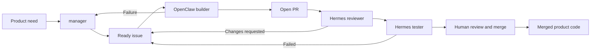

# Daily Briefing delivery report

Complete this after real VM runs. Replace placeholders with GitHub issue/PR URLs and observed evidence. Never report estimated counts as measured.

## Live system

- Public Daily Briefing product URL (latest briefing and run history; not an agent dashboard): TODO
- Repository and revision: TODO
- AWS EC2 instance type and region: TODO
- Reproduction: commit and publish the default branch; configure the AWS CLI profile and `infra/terraform.tfvars` (including your SSH `/32` and key paths); create local Git-ignored `agents/.env` or `agents/secrets.env` from `agents/.env.sample` with the Ollama and OpenRouter keys and `GH_TOKEN`; run `python agents/setup/apply.py`. This initializes Terraform, creates the VM and default network, installs the agent runtimes, enables the queue, and dispatches the manager. Record the product deployment and public serving commands here.

## Agent roster and contributions

Record the actual model and tools used in each run; do not substitute the configured model if a fallback ran.

| Agent | Runtime | Role | Model used | Tools used | Actual work | Issue/PR evidence |
| --- | --- | --- | --- | --- | --- | --- |
| manager | Hermes | Orchestrator and ticket owner | TODO | TODO | TODO | TODO |
| ingest | OpenClaw | Feed, persistence, and deduplication builder | TODO | TODO | TODO | TODO |
| page | OpenClaw | Public page builder | TODO | TODO | TODO | TODO |
| reviewer | Hermes | Independent PR reviewer | TODO | TODO | TODO | TODO |
| tester | Hermes | Independent acceptance tester | TODO | TODO | TODO | TODO |

## Ticket flow

## Results and trace

- First run, unchanged second run, one new item, and persisted failure: TODO with command output and public page evidence.
- Handoff issue comment and PR link: TODO.
- Review decision and test verdict: TODO.
- One real thing that broke, how it was detected, and how it was fixed: TODO with linked issue/PR and trace. If no failure occurred, say so instead of inventing one.
- What we would change next: TODO.

Run `python3 agents/trace-report.py --output .local-evidence/trace-excerpts.md` after the issue trail exists. Review that file and copy a few real, linked handoff and rejection or retry lines here. Keep the source links in this report.

## Model usage

Run `bash agents/usage-report.sh` and use `.local-evidence/usage/*.activity.json` plus their linked raw runtime reports as local evidence. Each dispatch records its agent, issue, actual reported model, phase, attempt, and tokens. Repeat dispatches for the same agent and issue enter the retries column. Unknown usage must stay unknown until an explicitly documented estimate is added with `agents/activity.py estimate`; include Hermes auxiliary tokens and explain any model attribution limits. Describe in plain words where the tokens went. Do not commit local evidence or credentials.

| Agent | Model | Planning tokens | Coding tokens | Review/test tokens | Retry tokens | Method |
| --- | --- | ---: | ---: | ---: | ---: | --- |
| manager | TODO | TODO | — | — | TODO | TODO |
| ingest | TODO | — | TODO | — | TODO | TODO |
| page | TODO | — | TODO | — | TODO | TODO |
| reviewer | TODO | — | — | TODO | TODO | TODO |
| tester | TODO | — | — | TODO | TODO | TODO |
